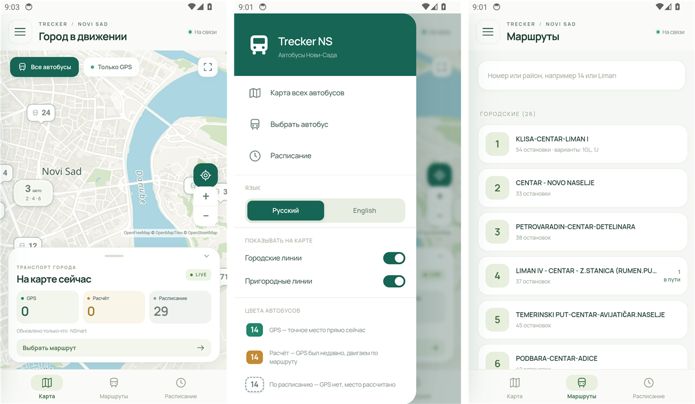

# NSmart Bus · Trecker NS

**Novi Sad buses on a map: GPS positions, stop arrivals, and timetables in one Android app.**

This repository is a fork of Paul’s [katurov/NSBusTablica](https://github.com/katurov/NSBusTablica), extended with the Trecker NS Android app. The original project’s history, server, and firmware are preserved. Its original documentation is available in [UPSTREAM.md](UPSTREAM.md); the app is located in [`app/`](app/).

Trecker NS helps you see where a bus is, choose a route, and find out when transport will arrive at your stop. The app uses NSmart data and the official GSP Novi Sad timetable. The interface is available in Russian and English, while route and stop names are preserved from their sources.

[**Download APK 2.1**](https://github.com/IlyaTechart/NSmart-Bus/releases/download/v2.1/Trecker.apk) · [All releases](https://github.com/IlyaTechart/NSmart-Bus/releases)



## Features

- A vector map with a custom light style: a blue Danube, green parks, and subdued street colors.
- Urban and suburban routes, with search by number or neighborhood name.
- Russian and English interface languages, switched instantly from the side menu and saved across restarts.
- Three position types: fresh GPS, an estimate based on the last GPS fix, and a timetable-based prediction.
- Estimated markers move along the road network between stops while preserving their ETA. Road geometry is bundled into the APK and does not require a separate routing server.
- A “GPS only” filter and a button to go to your own location.
- Nearby buses appear in clusters. Tap a cluster to zoom in.
- Tap the map status card to show or hide the position counts.
- Stop arrivals when you tap a stop circle, plus departure timetables from terminals.
- Close the stop panel with its close button or Android Back.
- Caching of the stop catalog, discovered routes, and timetables.

## Installation

1. Download [Trecker.apk from a release](https://github.com/IlyaTechart/NSmart-Bus/releases/latest).
2. Open the APK on Android and, if prompted, allow installation from the browser or file manager you used.
3. Launch the app with an internet connection. Location permission is needed only for the “Where am I” button.

**Android 7.0 or newer is required.** The map and current arrivals are downloaded from the network; this is not a fully offline app.

## What the colors mean

| Marker | Source | Interpretation |
| --- | --- | --- |
| Green · GPS | Fresh coordinates from NSmart | The latest known GPS position. It may also arrive with a delay. |
| Gold · Estimated | A previously received GPS fix and times to stops | An approximate position after the last fresh GPS fix. |
| Light · Timetable | The GSP timetable and known travel time | A prediction without real GPS. It does not confirm that the bus actually started its trip. |

NSmart provides arrival data for individual stops, so the app polls a set of stops and gradually builds a picture of traffic. Buses appear as responses arrive; the map does not guarantee complete transport coverage. A repeated response with the same coordinates is not treated as a new GPS fix.

The timetable shows **departure from the terminal**, not a promised arrival time at any stop. Times are calculated for the `Europe/Belgrade` time zone.

### Conservative NSmart polling

Since version 1.9, startup is faster: the first GPS request to a major stop in the visible area is sent before the basemap is initialized, and data is displayed as soon as the response arrives. The app schedules a stale catalog refresh after startup polling begins. Initial stops are selected to cover different local lines. Saved rate limits and error backoff periods are also respected during startup.

Since version 1.8, a shared limit of **20 network requests in any 60 seconds** applies, with at least **3 seconds** between requests and only one request in flight. It is shared by the map, manual refresh, the stop panel, and catalog downloads; moving the map does not reset it. Budget history and backoff periods are saved locally across app restarts.

A response for a stop is reused for **30 seconds**. Concurrent requests for it are coalesced, and ETAs are recalculated from the original response’s receipt time. The cache does not make GPS data fresher. In a wide view, polling every stop can take more than a minute; positions are estimated locally between responses.

After HTTP 403/429, the app pauses for at least **5 minutes**, increasing the pause on repeated errors up to **30 minutes**; a longer server-provided `Retry-After` is also respected. Other errors cause a growing pause from 15 seconds to 5 minutes. No new requests are sent in the background, including requests already waiting in the queue.

This is our load-reduction policy, not a published NSmart quota. The budget applies per app instance, not per external IP address: users on the same Wi-Fi/mobile network may share an address. In the APK, requests are sent from the client device. The browser `devserver` is a local development tool: its proxy sends requests from the computer running it.

Tapping a bus highlights the route and stops for its exact direction and line variant with a bright green line and a soft halo. In its card, tap “Show full route.” The close button above the map clears the selection; if a line was selected beforehand, its routes are restored. Selecting a bus does not send additional NSmart requests. An unavailable route is never replaced with another line, and sections without road geometry use approximate straight segments.

Road snapping covers Novi Sad and nearby areas. It uses the stop sequence and the OpenStreetMap road network rather than official bus route geometry. Outside the coverage area, or when no suitable path is available, approximate interpolation remains; this is noted in the bus popup. Special bus exceptions and all turn restrictions are absent from the vector data used. For details about the data and how to update it, see [`app/www/data/ROADS.md`](app/www/data/ROADS.md).

## Development

Trecker NS 2.1 renders the original HTML/CSS interface with Leaflet and MapLibre GL in Android WebView. Kotlin manages data requests and persistence. Rust parses transit data, calculates vehicle positions and arrivals, processes timetables, routes along roads and limits requests. The Android build connects these screens to Rust through a WebView adapter and JNI.

```text
app/
  native/               Gradle project and Kotlin Android app
  rust/                 Rust JNI library and host-side tests
  www/                  shared interface, browser model and reference data
  tools/                test fixtures and native asset preparation
  build.ps1             Rust + Kotlin APK build and signing
```

The bundled station catalogue, learned routes and road graph are generated from `www/data` by `tools/prepare-native.cjs`. They are build artifacts and are not duplicated in Git under `native/app/src/main/assets`.

### Checks

Rust tests use saved NSmart/GSP responses and require no network access:

```sh
node app/tools/prepare-native.cjs
cargo test --locked --manifest-path app/rust/Cargo.toml
```

The tests cover response parsing, real route projection, repeated GPS observations, timetable parsing, Serbian holidays, rolling request limits, backoff and loading the bundled station/route/road data. The legacy web implementation can still be checked with `npm test` and `npm run test:ui` from `app`.

### Building the APK on Windows

Required tools: JDK 17, Node.js 18+, Rust with `aarch64-linux-android`, `armv7-linux-androideabi` and `x86_64-linux-android` targets, `cargo-ndk`, Gradle 8.9, Android SDK 34/build-tools 34 and NDK 27.2.12479018.

Expected tool directory structure:

```text
trecker-tools/
  jdk/bin/java.exe
  node/node.exe
  gradle-8.9/bin/gradle.bat
  sdk/platforms/android-34/android.jar
  sdk/build-tools/34.0.0/
  sdk/ndk/27.2.12479018/
```

```powershell
$env:TRECKER_TOOLS = 'C:\path\to\trecker-tools'
powershell -ExecutionPolicy Bypass -File app/build.ps1
```

The script prepares bundled data, compiles Rust for ARM64, ARMv7 and x86_64, packages the WebView interface with Gradle, aligns and signs the APK. The result is `Trecker.apk` in the project root. `GRADLE_HOME` can override the Gradle location.

The `app/android/trecker.keystore` signing key is not stored in the repository. The script checks the release certificate before copying the APK. To use the release key stored elsewhere, set `TRECKER_KEYSTORE` to its path before running the script. An APK signed with a different key cannot be installed over the release version as an update.

## Sources and acknowledgments

- [NSmart](https://online.nsmart.rs/) — transport arrival and movement data.
- [GSP Novi Sad](https://www.gspns.rs/) — the official timetable.
- [OpenFreeMap](https://openfreemap.org/), [OpenMapTiles](https://openmaptiles.org/), [OpenStreetMap](https://www.openstreetmap.org/copyright) — map data and the vector basemap.
- [Leaflet](https://leafletjs.com/), [MapLibre GL JS](https://maplibre.org/), Leaflet.markercluster, and Manrope — libraries and the font. Licenses for bundled components are in `app/www/lib/`.
- [katurov/NSBusTablica](https://github.com/katurov/NSBusTablica) — approaches to working with NSmart, handling stale coordinates, and making predictions; the provenance of the test data is described in `app/tools/fixtures/README.md`.

This is an independent project, not an official NSmart or GSP Novi Sad app. Data availability and prediction accuracy depend on external services.
