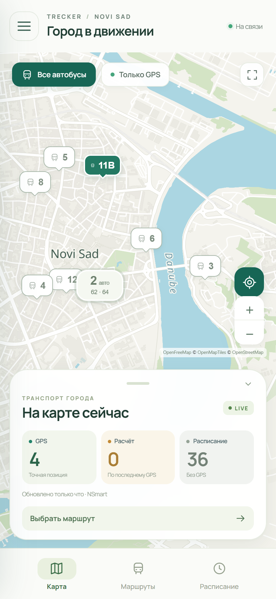
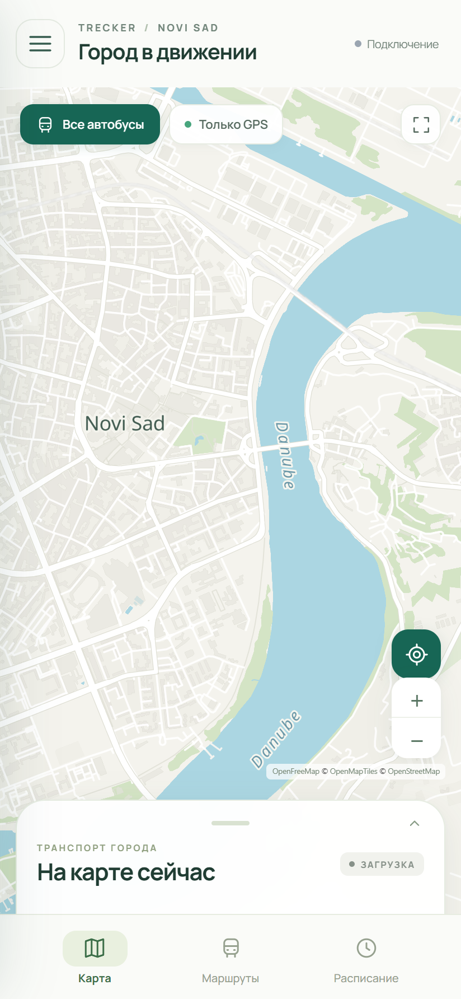
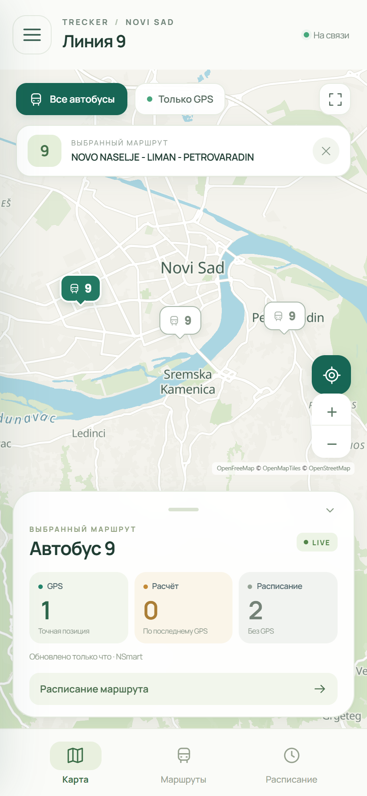

# NSmart Bus · Trecker NS

**Автобусы Нови-Сада на карте: GPS-позиции, прибытия на остановки и расписание в одном Android-приложении.**

Этот репозиторий — форк проекта Павла [katurov/NSBusTablica](https://github.com/katurov/NSBusTablica), дополненный Android-приложением Trecker NS. История, сервер и прошивки исходного проекта сохранены. Его оригинальная документация находится в [UPSTREAM.md](UPSTREAM.md); приложение — в папке [`app/`](app/).

Trecker NS помогает посмотреть, где едет автобус, выбрать маршрут и узнать, когда транспорт прибудет на нужную остановку. Приложение использует данные NSmart и официальное расписание GSP Novi Sad. Интерфейс — на русском, названия маршрутов и остановок сохраняются из источников.

[**Скачать APK 1.6**](https://github.com/IlyaTechart/NSmart-Bus/releases/download/v1.6/Trecker.apk) · [Все релизы](https://github.com/IlyaTechart/NSmart-Bus/releases)

<p>
  
  
  
</p>

## Возможности

- Векторная карта с собственным светлым стилем: голубой Дунай, зелёные парки и спокойные цвета улиц.
- Городские и пригородные маршруты, поиск по номеру или названию района.
- Три типа позиций: свежий GPS, расчёт по последнему GPS и прогноз по расписанию.
- Движение расчётных меток по дорожной сети между остановками с сохранением ETA. Геометрия включена в APK и не требует отдельного сервера маршрутизации.
- Фильтр «Только GPS» и переход к собственному местоположению.
- Группировка близких автобусов с количеством и номерами маршрутов. Нажатие приближает группу, а на крупном масштабе раскрывает совпадающие метки веером.
- Сворачиваемая карточка «На карте сейчас»: потяните вниз за верхнюю часть или нажмите стрелку. Свайп вверх раскрывает её обратно.
- Прибытия на остановку по нажатию на её кружок и расписание отправлений с конечных.
- Кэширование каталога остановок, изученных маршрутов и расписаний.

## Установка

1. Скачайте [Trecker.apk из релиза](https://github.com/IlyaTechart/NSmart-Bus/releases/latest).
2. Откройте APK на Android и, если потребуется, разрешите установку из выбранного браузера или файлового менеджера.
3. Запустите приложение с подключением к интернету. Разрешение на геолокацию нужно только для кнопки «Где я».

Требуется **Android 7.0 или новее**. Карта и актуальные прибытия загружаются из сети; это не приложение для полноценной работы офлайн. Для векторной карты нужен WebView с поддержкой WebGL; при его отсутствии включается резервная растровая карта.

## Что означают цвета

| Метка | Источник | Как понимать |
| --- | --- | --- |
| Зелёная · GPS | Свежие координаты из NSmart | Последняя известная GPS-позиция. Она тоже может приходить с задержкой. |
| Золотистая · Расчёт | Ранее полученный GPS и времена до остановок | Приблизительная позиция после последнего свежего GPS. |
| Светлая · Расписание | Расписание GSP и известное время движения | Прогноз без реального GPS. Он не подтверждает, что автобус действительно вышел на рейс. |

NSmart предоставляет данные о прибытиях к отдельным остановкам, поэтому приложение опрашивает набор остановок и постепенно собирает картину движения. Автобусы появляются по мере получения ответов; карта не гарантирует полный охват транспорта. Повторный ответ с теми же координатами не считается новым GPS-замером.

В расписании показано **отправление с конечной**, а не обещанное время прибытия на любую остановку. Время рассчитывается для часового пояса `Europe/Belgrade`.

Дорожная привязка покрывает Нови-Сад и ближайшие окрестности. Она использует последовательность остановок и дорожную сеть OpenStreetMap, а не официальную геометрию автобусного маршрута. Вне покрытия или при отсутствии подходящего пути остаётся приблизительная интерполяция; это указано в окне автобуса. Специальные автобусные исключения и все ограничения поворотов в используемых векторных данных отсутствуют. Подробнее о данных и их обновлении — в [`app/www/data/ROADS.md`](app/www/data/ROADS.md).

## Разработка

Приложение состоит из HTML/CSS/JavaScript в Android WebView и небольшой Java-оболочки. Оболочка выполняет сетевые запросы к NSmart/GSP, обрабатывает разрешение геолокации и системную кнопку «Назад». Сервер для работы APK не требуется.

```text
app/
  www/                  интерфейс, карта, модель движения и встроенные библиотеки
  android/              Java-оболочка, AndroidManifest и ресурсы
  tools/                локальный сервер, тесты и тестовые данные
  build.ps1             сборка и подпись APK
docs/images/            скриншоты интерфейса
```

### Запуск в браузере

Понадобится Node.js 18 или новее:

```sh
cd app
npm start
```

Откройте `http://localhost:8787`. Локальный сервер проксирует запросы к источникам данных, заменяя Android-мост. Запускайте его только в доверенной локальной среде. Для просмотра отдельного маршрута можно использовать `http://localhost:8787/#focus=9`.

### Проверки

Основные тесты не требуют установки npm-пакетов или доступа к сети:

```sh
cd app
npm test
```

Для проверок интерфейса установите зависимости и Chrome, затем запустите локальный сервер в отдельном терминале:

```sh
npm ci
npm start
```

В другом терминале, в папке `app`:

```sh
npm run test:ui
npm run preview
```

При нестандартном расположении Chrome задайте переменную окружения `CHROME_PATH` с путём к исполняемому файлу. Тест интерфейса проверяет реальные touch-жесты, сворачивание панели, сохранность автобусов при масштабировании, раскрытие групп и GPS-фильтр. Для воспроизводимых проверок группировки используются тестовые позиции; они не попадают в приложение. Проверка `preview` работает с сетевыми источниками и сохраняет скриншоты.

### Сборка APK на Windows

Нужны JDK 17 и Android SDK с `platforms;android-34` и `build-tools;34.0.0`. Android Studio и Gradle не обязательны.

Ожидаемая структура каталога инструментов:

```text
trecker-tools/
  jdk/bin/java.exe
  sdk/platforms/android-34/android.jar
  sdk/build-tools/34.0.0/
```

```powershell
$env:TRECKER_TOOLS = 'C:\path\to\trecker-tools'
powershell -ExecutionPolicy Bypass -File app/build.ps1
```

Результат — `Trecker.apk` в корне проекта. Без `TRECKER_TOOLS` используется папка `trecker-tools` в профиле текущего пользователя.

Ключ подписи `app/android/trecker.keystore` не хранится в репозитории. Если его нет, скрипт создаёт локальный ключ для разработки. APK, подписанный другим ключом, не установится поверх релизного как обновление. Сохраняйте свой ключ для последующих собственных сборок.

## Источники и благодарности

- [NSmart](https://online.nsmart.rs/) — сведения о прибытиях и движении транспорта.
- [GSP Novi Sad](https://www.gspns.rs/) — официальное расписание.
- [OpenFreeMap](https://openfreemap.org/), [OpenMapTiles](https://openmaptiles.org/), [OpenStreetMap](https://www.openstreetmap.org/copyright) — картографические данные и векторная подложка.
- [Leaflet](https://leafletjs.com/), [MapLibre GL JS](https://maplibre.org/), Leaflet.markercluster и Manrope — библиотеки и шрифт. Лицензии встроенных компонентов находятся в `app/www/lib/`.
- [katurov/NSBusTablica](https://github.com/katurov/NSBusTablica) — идеи работы с NSmart, обработки устаревших координат и прогнозов; происхождение тестовых данных описано в `app/tools/fixtures/README.md`.

Это независимый проект, не официальное приложение NSmart или GSP Novi Sad. Доступность данных и точность прогнозов зависят от внешних сервисов.
